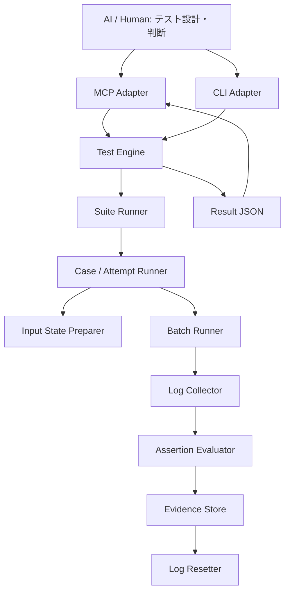

# アーキテクチャ



## 責務
- 上流AI/人：対象分析、テスト定義、期待値、結果分析、再試行判断。
- MCP：定義保存・検証、実行指示、状態・結果・証跡参照。
- Engine：定義どおりの準備、実行、機械的照合、保存、リセット。テスト計画を自律変更しない。

## 実行単位
- Suite：複数Caseと実行順序・停止条件。
- Case：初期状態、複数Batch、期待値、ログ定義。
- Attempt：Caseの一度の試行。再実行は新しいIDを採番し不変保存。
- Batch：許可済みCLIターゲット、引数、環境変数、タイムアウト。

初期版は逐次実行。各Caseの初期状態を再構築する。バッチごとの失敗時継続可否を定義する。実行状態・合否・証跡状態・クリーンアップ状態を独立記録する。

## 予定コード構成
```text
src/cli_test_mcp/
  cli.py
  engine/{suite_runner,case_runner,batch_runner,setup,assertions}.py
  evidence/{collector,manifest,reset}.py
  definitions/{loader,validator}.py
  mcp/{server,tools}.py
schemas/{suite,case,result}.schema.json
tests/{unit,integration,fixtures}/
examples/basic/
```

依存方向はMCP/CLI → Engine。EngineはMCP SDKに依存しない。

## 異常系
定義不備は実行前拒否。バッチ失敗とテスト不合格を区別。証跡保存失敗ならログリセット禁止。中断時に実行中だったバッチを無条件に再実行しない。
